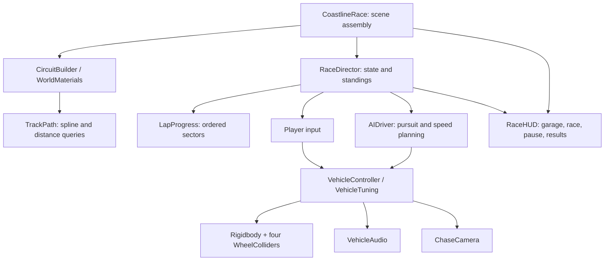

# Coastline Rush design

## Goal and scope
A small, polished, single-player coastal club racer that is easy to run, study,
and extend in Unity 6.3 LTS. The handling should communicate braking distance,
weight, tire grip and road surface without demanding simulation expertise.
The current vertical slice includes two circuits, three car bodies, six-driver
racing, time trial, difficulty, dry/wet grip, recovery, saved best laps and menus.

## Design principles
- Player and AI use the same vehicle simulation. AI submits throttle, brake,
  steering and boost inputs; it does not move transforms around the circuit.
- Run physics in FixedUpdate, sample controls in Update and follow in LateUpdate.
  Pause stops the physics clock and race timer together.
- Use meters, seconds and kilograms. Keep handling parameters in an Inspector
  asset so tuning does not require rewriting the controller.
- Prioritize believable, responsive behavior. Steering assistance is modest and
  can be disabled. Suspension, collisions and contact forces are genuine PhysX.
- Separate race correctness from presentation. Ordered sectors prevent shortcut
  and reverse-lap exploits; the camera and HUD consume race state.
- Use assets with redistribution rights and preserve original license files.
- Validate changes with braking, collision and complete-race checks, then playtest.

## Architecture

`CoastlineRace` retains the original scene script GUID and is the composition
root. The scene contains this component; road, scenery and cars are created at
runtime. `BuildRace` prepares the tuning asset and can package a macOS player.

`TrackPath` samples a closed Catmull-Rom curve and stores cumulative arc length.
Nearest segment projection produces signed lateral displacement and distance.
The road uses a continuous MeshCollider; Armco barriers use static BoxColliders.
A matching terrain mesh prevents suspension falling through the scenery.

`VehicleController` owns the Rigidbody, wheel contacts, drivetrain, steering,
traction control, anti-roll force and nitro. Decorative body and wheel animation
follow the physical vehicle. Skid trails and engine/tyre/impact audio provide
feedback. Audio crossfades shared idle/load combustion loops with smoothed RPM,
throttle load and gear shift dips; tyre scrub follows grounded lateral slip. Road
noise, nitro and collision voices are independent of the engine mix. Race cues
are tied to state transitions. All sounds are reproducible original synthesis.
Josefin Sans uses actual regular/semibold/bold font files rather than synthetic
bold styling. The three car choices currently share one tune to keep the racing fair.

`AIDriver` uses pure pursuit to follow a lane offset. It estimates upcoming corner
speed from curvature and constrains the approach speed using braking distance.
Nearby racers affect passing and braking. Recovery returns to a completed sector;
player recovery has a five-second penalty.

`RaceDirector` owns Garage, Countdown, Racing, Paused and Results states. Each
entrant has a `LapProgress`. A valid lap requires 12 ordered sectors and a forward
finish crossing. Best laps are keyed by circuit version, car and weather so the
prototype's incompatible records cannot affect the new game.

## Handling decisions
WheelCollider was chosen over custom raycast tire forces because the installed
Unity version includes a suspension/friction implementation, collision contacts
and wheel poses. The controller keeps the force model explicit and the settings
small. A more complex tire model is deferred until measurement identifies a need.

The model is an arcade/simcade starting point, not a realistic vehicle simulator:
there is no clutch, differential model, tire temperature, tire wear or damage
simulation. The displayed five gears drive audio feedback; wheel torque follows
a tunable speed curve, not a full gearbox. Wet weather changes grip and lighting;
it does not simulate rain droplets or standing water.

## Performance and acceptance
Target: steady 60 FPS on the current Apple Silicon Mac with six cars.
This is a target until measured in the standalone player. Use Unity's profiler
before increasing crowd count, asset density, shadow range or tire complexity.
Meshes/materials are shared and created resources are released on world rebuild.
The smooth racing guide can be disabled. All art is local after checkout.

Acceptance checks:
1. All four wheels settle on the surface and the chassis remains upright.
2. Car accelerates, brakes, steers, drains boost and collides with a solid barrier.
3. Pause freezes vehicle position and timing; restart clears transient state.
4. The AI player completes three physical laps with every sector and no recovery.
5. Garage, car/track/weather changes, pause, time trial and results are usable.
6. macOS build succeeds and presents the same garage and race.

## Next development milestones
- Tune each car into a distinct class after telemetry-based handling playtests.
- Add a ghost for time trial, controller support, input rebinding and accessibility.
- Move menu layout to UI Toolkit when controller navigation and localization land.
- Bake or author editor-visible tracks/prefabs and add a track-authoring workflow.
- Profile resource loading, add LODs and strip unused art from release builds.
- Add automated licensed Unity CI and versioned release builds.
- Add multiplayer only after defining authority, synchronization and cheating rules.
