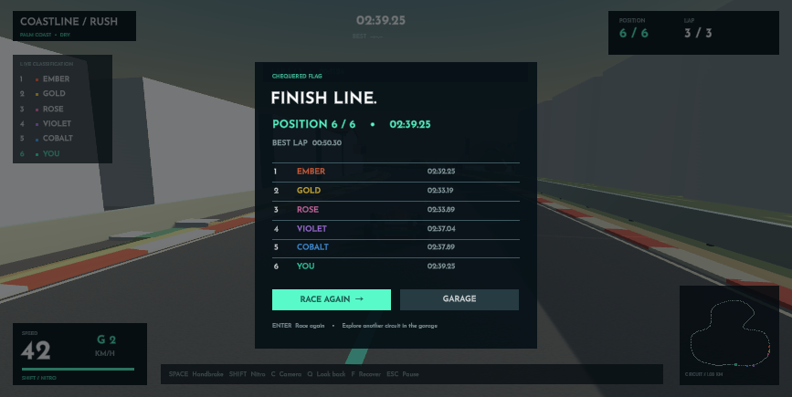

# Coastline Rush

A Unity C# coastal club racer with physical cars, shared player/AI handling and
openly redistributable artwork. Built with **Unity 6000.3.25f1**.

## Play in Unity
1. Add this repository folder in Unity Hub and open it with Unity 6000.3.25f1.
2. Choose **Coastline Rush > Play Race** from the editor menu.
3. Select your car, circuit, event, difficulty, lap count and weather in the garage.
4. Start the race and click inside the Game view to drive.

| Controls | Action |
|---|---|
| W / Up | Accelerate |
| S / Down | Brake, then reverse |
| A, D / Left, Right | Steer |
| Space | Handbrake |
| Shift | Nitro |
| C | Cycle chase, hood and wide cameras |
| Q | Look back |
| F | Recover at last completed sector (+5 seconds) |
| Escape | Pause / resume |
| R | Restart |
| Enter | Start / race again |
| H | Show handling telemetry |

## Features
- Three Kenney car bodies with animated wheels.
- Two smooth, closed circuits with elevation, curbs and solid barriers.
- Six-driver races or solo time trial; three AI difficulty levels.
- Rigidbody and four WheelColliders: suspension, anti-roll forces, tire grip,
  torque, braking, traction control, aero drag and nitro.
- AI steers and brakes the same physical cars, with corner anticipation and traffic response.
- Dry/sunset and wet/overcast presets; off-road grip and drag.
- Garage, countdown, standings, speed/gear display, minimap, pause and results.
- Optional racing guide and steering assist; locally saved settings and best laps.
- Josefin Sans typography with the original SIL OFL license included.
- Layered engine audio, tyre scrub, wind, nitro, impact and race cues.
- Separate master, engine and effects levels; skid trails and camera feedback.
- Imported CC0 car, pit-road, grandstand, garage, flag, palm and rock assets.

This is a playable vertical slice, not a finished commercial game or a realistic
vehicle simulator. Gear display/audio uses a simplified speed-based system.
Weather changes grip and lighting. Multiplayer, controller rebinding, damage,
replays and tire-temperature simulation are future work.

## Tune and extend
Use **Coastline Rush > Prepare Scene and Handling Asset** to create
`Assets/Resources/ClubHandling.asset`. Select it in the Inspector to tune the
chassis, spring/damper, steering, grip, torque, braking and boost parameters.
All three car choices initially share that tune.

Code is separated into `Vehicles`, `Racing`, `World`, `Presentation` and `Core`.
See [Design](Docs/Design.md), [Research](Docs/Research.md) and
[Contributing](CONTRIBUTING.md).

## Validate
- **Coastline Rush > Validation > Run Track and Race Rules Checks** checks
  circuit seams, distance projection, three-lap progress, reverse driving and shortcuts.
- **Run Physics and Full Race Checks** drives the actual car through acceleration,
  braking, steering, boost, barrier collision, pause, restart and a three-lap race.
  It writes a report to `Logs/physics-validation.json`. Checks run in Play mode,
  use a temporary AI driver and do not save best-lap records.
- `python3 scripts/check_repository.py` checks asset metadata, licenses, package
  lock consistency and scene references. The included GitHub workflow runs this
  checkout check; it does **not** claim to run licensed Unity physics/build tests.

## Build
Choose **Coastline Rush > Build macOS Game**, then open
`Build/Coastline Rush.app`. For a terminal build, close the editor and run
`scripts/build-macos.sh` with a valid Unity license. Build outputs are ignored by Git.

## License and artwork
Original code: [MIT](LICENSE). Imported artwork: Kenney CC0, with original license
files preserved. Typography: Josefin Sans, SIL OFL 1.1. Original synthesized
audio: MIT. See [Third-party notices](ThirdPartyNotices.md) for pack versions,
sources and uses. All required art is included; no Asset Store login or download
is needed after checkout. Unity binaries are not included.
